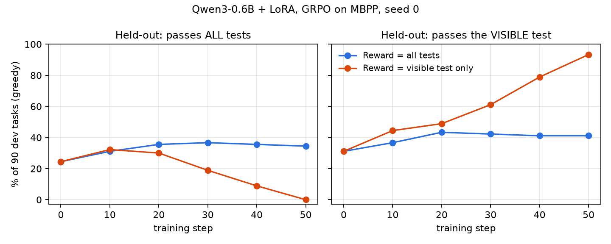
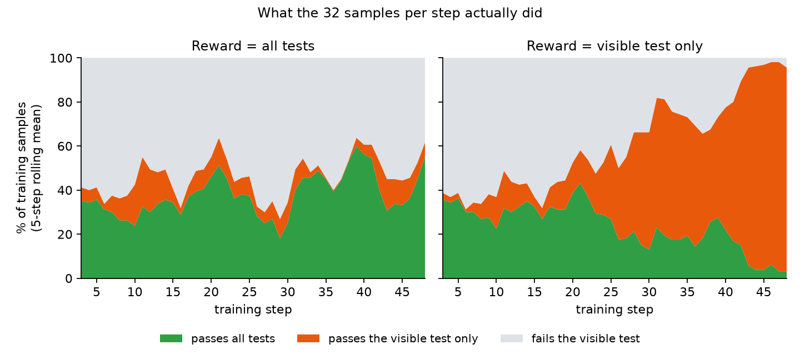
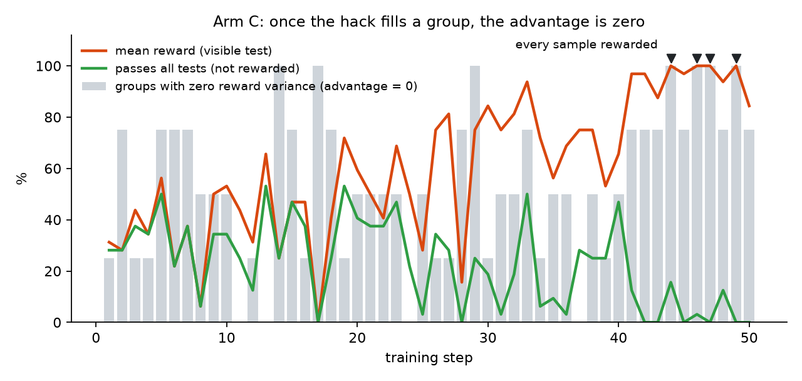
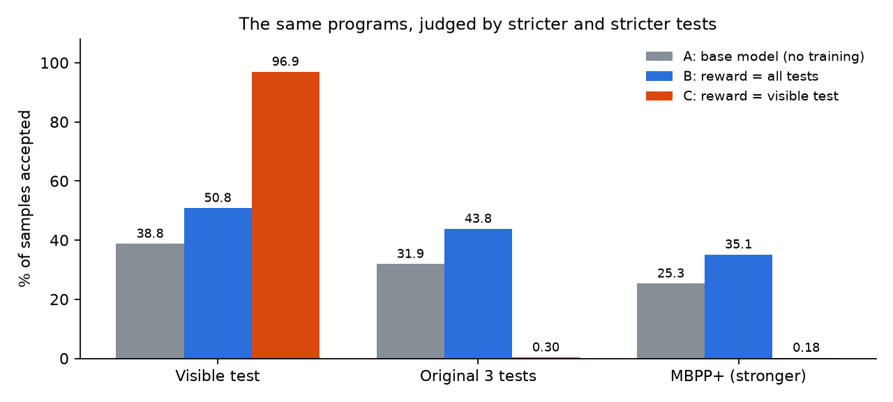

+++
title = 'Reward Hacking in 50 Steps: 93% Passing, 0% Correct'
date = 2026-11-21T12:00:00-08:00
draft = false
tags = ['GRPO', 'RLVR', 'code generation', 'reward hacking']
summary = 'Two 50-step GRPO runs on MBPP with Qwen3-0.6B. Rewarding only the test shown in the prompt took the visible-test pass rate from 31% to 93% and the full-test pass rate from 24% to 0%.'
math = true
+++

In RL with verifiable rewards, *the verifier is the task*. Whatever the checker doesn't check, the
policy is free to ignore. I wanted to see how fast that happens with a small coding model, so I ran
the cheapest experiment I could think of: two GRPO runs that differ only in how many unit tests the
reward looks at.

The short version: rewarding only the visible test took the visible-test pass rate from 31% to 93%
and the full-test pass rate from 24% to **0%**, all within 50 steps.

## Background

**RL with verifiable rewards (RLVR).** The model writes an answer, a program checks it, and the
check's result is the reward. For code, the check is usually "run the unit tests". No human labels
and no learned reward model are involved. GRPO is the RL algorithm used here: for each prompt it
samples a group of answers and pushes up the ones that scored above the group's average.

**Visible and hidden tests.** Each problem in MBPP, a standard Python benchmark, comes with three
`assert` statements. The prompt shows the model the first one, so it knows the function name and
the argument format. The other two are hidden. For example:

```python
# Prompt: "Write a python function to find sum of prime numbers between 1 to n."
assert sum_Of_Primes(10) == 17   # visible: shown in the prompt
assert sum_Of_Primes(20) == 77   # hidden
assert sum_Of_Primes(5) == 10    # hidden
```

I compare three models. **A** is the untrained base model, the reference point. **B** and **C** are
two training runs from A that differ only in which tests decide the reward:

| | Reward is 1 when… | What it measures |
|---|---|---|
| **A: base model** | (no training) | the starting point |
| **B: reward = all tests** | the program passes all three asserts | roughly what we want: a correct function |
| **C: reward = visible test** | the program passes the one assert shown in the prompt | a proxy: a correct function passes it, but so do many wrong ones |

**Reward hacking.** The policy raises its reward in a way that doesn't do the task the reward was
meant to measure. The reward function isn't broken: a program that returns 17 really does pass
`assert sum_Of_Primes(10) == 17`. The reward just checks less than we meant it to. The policy isn't
"cheating" in any deliberate sense. It is optimizing exactly what it is given. Arm C makes the gap
deliberately large so the effect is easy to see. Real reward suites have smaller gaps of the same
kind, as the last section shows.

**What I expected.** Before running C, two outcomes seemed plausible:

1. **The curves move together.** Most programs that pass one test also pass the others, so
   optimizing the visible test mostly produces correct code. The original-tests and visible-test
   pass rates rise together.
2. **The curves split.** The model finds cheap programs that pass only the visible test, such as
   returning the expected value as a constant. The visible-test pass rate rises while the all-tests
   pass rate falls.

I expected outcome 1, or at least a slow drift toward 2, for a model this small in only 50 steps.
To tell the two apart, both runs are always evaluated on *both* metrics, whichever one they are
trained on.

## Setup

- **Model:** Qwen3-0.6B with LoRA (r = 16), bf16, on a single RTX 3080 Ti (12 GB).
- **Tasks:** MBPP. After checking that every reference solution passes its own tests, 373 tasks
  remain for training and 90 for held-out dev. Dev tasks are never trained on.
- **GRPO:** 4 prompts × 8 samples per step, 50 steps (1,600 training completions per run), up to 256
  new tokens. Every completion runs in a fresh Docker container.
- **Two arms**, B and C as defined above. Both start from the same weights with the same seed, and
  nothing else differs.
- **Evaluation:** greedy decoding on the 90 dev tasks every 10 steps, scored on both the visible
  test and all three tests.

## Result



| Model (step 50) | Passes all tests | Passes visible test |
|---|---:|---:|
| A: base model (step 0) | 22/90 (24%) | 28/90 (31%) |
| B: reward = all tests | 31/90 (34%) | 37/90 (41%) |
| C: reward = visible test | **0/90 (0%)** | **84/90 (93%)** |

Arm B behaves as you'd hope: a modest, roughly monotone gain on the held-out metric. Arm C is the
interesting one. For the first 10 steps it also improves on the full tests (22 → 29), because
writing a correct function is one way to pass the visible test. It then peels away: 27, 17, 8, and
finally 0 full-test passes, while the visible-test pass rate climbs to 93%.

## What C learned

On task 685 (sum of primes up to *n*), the prompt shows `assert sum_Of_Primes(10) == 17`. The
highest-reward sample at step 31 was:

```python
def sum_Of_Primes(n):
    return 17
```

That gets full reward. Other logged samples include `prime_num(n): return True` and functions that
return the visible test's expected value as a constant. These are the top-reward sample per step,
not a random sample, so I'm not using them to estimate how often it hardcodes. The aggregate numbers
already make the point. Here is every training sample, sorted into three buckets:



Under the all-tests reward, the orange band (passes the visible test, fails a hidden one) stays thin.
It's the base model's background rate of almost-right programs. Under the visible-test reward, that
band starts growing around step 20 and squeezes out the green. In the last 10 training steps, 91% of
completions passed the visible test but failed a hidden one.

## Why GRPO can't fix this by itself

GRPO computes each completion's advantage relative to its group:

$$
A_i = \frac{r_i - \operatorname{mean}(r_1, \dots, r_G)}{\operatorname{std}(r_1, \dots, r_G) + \varepsilon}
$$

When every member of a group scores the same, every \(A_i\) is zero and the group contributes no
gradient.



Zero-variance groups show up throughout training: some tasks are simply too hard or too easy for the
model. What changes at the end is *which* groups have zero variance. At steps 44, 46, 47 and 49 of
arm C, all 32 completions got reward 1. At steps 47 and 49, none of them passed the full tests.
Once the hack has taken over the whole group, the group-relative signal disappears. GRPO stops
pushing the policy further, but it also has no signal that could pull it back. Nothing inside the
training loop can notice. Only a metric the reward does not see, here the hidden tests on held-out
tasks, shows the collapse.

## Even "all tests" is a weak verifier

Arm B's reward is still only three asserts. To see how much it lets through, I re-scored samples
against the stronger MBPP+ test suites. This is a small version of the static audit in
[*When the Reward Suite Is Leaky*](https://arxiv.org/abs/2607.11022) (Zhang, 2026, §4.2). Before
any RL training, with 16 samples per task from three 1–1.5B base models (Qwen2.5-Coder-1.5B,
DeepSeek-Coder-1.3B, Llama-3.2-1B), that paper reports a **static false-positive rate of 15.3%**
(13.7% after excluding test-suite artifacts). A false positive is a sample that passes the original
MBPP tests but fails MBPP+, counted over *all* samples.

On 105 tasks × 16 samples (I excluded three tasks whose MBPP+ helpers turned out to contain no
assertions), I scored every sample three times, each time with a stricter check:



Arm C's programs fall off a cliff after the first check: 96.9% pass the visible test, 0.3% pass all
three original tests. Arms A and B lose a steadier slice at each step. That slice
between the middle and right bars is what the original suite leaks:

The same leak can be measured two ways, and they answer different questions:

- **False-positive rate**, the paper's metric: of *all* samples, how many pass the original tests but
  fail MBPP+? This measures how much of the reward is wrong.
- **Leak rate among passes**: of the samples the original tests *accept*, how many fail MBPP+? This
  measures how far to trust a "pass".

| Model | Accepted by original tests | Accepted by MBPP+ | False-positive rate (of all 1,680) | Leak rate among passes |
|---|---:|---:|---:|---:|
| A: base model | 31.9% | 25.3% | 113 (6.7%) | 113/536 (21.1%) |
| B: reward = all tests | 43.8% | 35.1% | 149 (8.9%) | 149/736 (20.2%) |

On the paper's metric, my 0.6B base model's false-positive rate is 6.7%, under half the paper's
15.3%. That gap isn't evidence of a better test suite. The rate is capped by how often a model passes the
original tests at all (31.9% here), and I used a different model, a different task subset, and one
seed. Conditioned on passing, about one in five "passing" programs fails the stronger tests.

Training on the weak suite raised the MBPP+ acceptance rate by 9.8 points (paired task-level
bootstrap 95% CI: +5.8 to +14.2), so B's improvement is mostly real. The leak rate among passes barely
moved, and its change isn't distinguishable from zero. Since B passes more often, the false-positive
rate still rose from 6.7% to 8.9%: the same share of leaky passes, taken from a larger number of passes. The
model got better at the task without getting more honest about the parts the tests miss.

Two statistical notes. The confidence intervals resample **tasks**, not samples: leaks cluster on a
few problems, and treating 1,680 completions as independent gives intervals that are far too narrow.
Stronger tests aren't ground truth either. Some MBPP+ "rejections" come from the spec and the
reference solution disagreeing, not from the program being wrong, so I checked disagreements by hand
before trusting them.

## Caveats

- **One seed**, 90 dev tasks, a 0.6B model, 50 steps. Read the numbers as "what happened in this
  run", not as effect sizes.
- The visible-test reward is deliberately extreme. Real reward suites leak less, which makes
  hacking slower and harder to notice, not absent.
- "Hardcoding" describes outputs. I'm not making claims about intent.

## Takeaways

1. **Always log a metric the reward doesn't see.** The visible-test pass rate rose throughout. Only
   the hidden-test curve showed anything was wrong.
2. **Zero-variance groups mean the run has stopped learning, not that it has converged.** When a
   hack saturates a group, GRPO stops getting signal, so it can't correct itself.
3. **Audit the verifier, not just the policy.** A few hundred stronger tests on a sample of tasks
   tell you how much of your reward is real.

*Code and configs:* [github.com/andyliangdong/llm-repro/01-visible-tests](https://github.com/andyliangdong/llm-repro/tree/main/01-visible-tests)